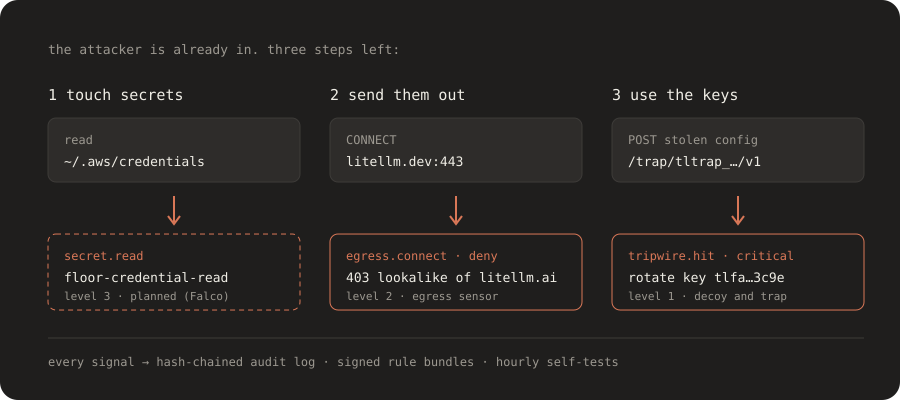
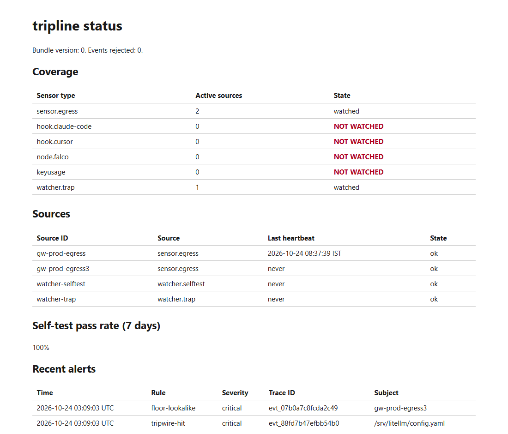

<div align="center">

# tripline

### Assume something gets in. Make sure it leaves with nothing.

[](https://github.com/Parthkomalwad/tripline/actions/workflows/ci.yml)
[](LICENSE)
[](go.mod)
[](go.mod)
[](docs/release.md)

[Quickstart](#quickstart) · [How it works](#how-it-works) · [Threat model](docs/threat-model.md) · [Replay lab](replays/litellm-2026-10/README.md) · [Docs](#documentation)

<br>

<picture>
  <source media="(prefers-color-scheme: dark)" srcset="docs/assets/hero-dark.svg">
  <source media="(prefers-color-scheme: light)" srcset="docs/assets/hero-light.svg">
  
</picture>

</div>

## What it solves

You run AI systems yourself: an AI gateway such as LiteLLM, agents, MCP servers, coding agents. They hold provider keys and cloud credentials. A malicious package or a prompt-injected agent can get in, and you cannot predict how.

tripline does not try to predict the way in. It watches the few things every attack must do after it gets in:

1. **Touch secrets.** Credential-file reads and decoy files that nobody should open.
2. **Send them out.** Connections to unknown or lookalike domains, and requests that carry a foreign API key.
3. **Use them.** A stolen decoy config that points at a trap.

It alerts when those happen, proves every hour that its own protections still work, and is built so the security tool itself is hard to compromise.

> **Watch-only by default.** Nothing blocks traffic until you set `mode: enforce` in a signed rule bundle.

## Quickstart

Level 1 runs the watcher, plants decoys and serves a trap. It does not sit in your traffic path. You need Go (see `go.mod`) and [just](https://github.com/casey/just).

```sh
git clone https://github.com/Parthkomalwad/tripline.git
cd tripline
just build
export PATH="$PWD/bin:$PATH"
mkdir ~/tripline-demo
tripline init -dir ~/tripline-demo
cd ~/tripline-demo
tripline watcher -config tripline.yaml &
sleep 2   # let the watcher open its ports
tripline status -config tripline.yaml
```

`tripline init` prints a sensor token once, and the paths of two decoy files. Store the token. Copy the decoys to where an attacker would look. [docs/quickstart.md](docs/quickstart.md) shows how to trip a decoy, and how to set up Level 2 and provider mode.

The status page runs on `127.0.0.1:7701`:

<div align="center">

</div>

## How it works

| Level | You deploy | It catches | State |
|---|---|---|---|
| 1 | Watcher, decoys and a trap | A stolen decoy config used anywhere in the world | Built |
| 2 | Egress sensor (CONNECT proxy) | Unapproved and lookalike destinations, in monitor or enforce mode | Built |
| 2 | Provider mode | Requests that carry a foreign API key. The gateway holds no real keys. | Built |
| 3 | Falco rules, coding-agent hooks | Credential-file reads, agent-config edits, MCP tool changes | Planned |
| 1 | Key-usage connectors | Stolen keys used from new networks | Planned |

Sensors send events to the watcher. The watcher evaluates rules, links events into chains (a secret read followed by a denied connection on the same system), writes everything to a hash-chained audit log, and sends alerts to Slack, a webhook or stdout. Each alert says what happened, what was already done, what you must do, and its trace ID.

### Built to be hard to turn against you

- **One static binary.** Two dependencies: `gopkg.in/yaml.v3` and `golang.org/x/net` (Public Suffix List only).
- **Signed rule bundles.** Two of N Ed25519 signatures, rollback protection, and a delay before any loosening takes effect. Sensors verify each bundle themselves and do not trust the watcher.
- **Floor rules** compiled into the binary. A bundle can add to them but never weaken them.
- **Hourly self-tests** try to break the rules and show the pass rate.
- **Signed, reproducible releases.** Cosign keyless signatures, SBOM and build provenance. Two CI runners must build identical binaries.

## See it catch an attack

The [replay lab](replays/litellm-2026-10/README.md) recreates the shape of the October 2026 LiteLLM compromise with decoy data on a network with no internet route. CI runs it on every change.

```sh
just replay 1            # decoy use detected at the trap
just replay 2 enforce    # lookalike connection denied, even with the watcher killed
```

## Documentation

- [Quickstart](docs/quickstart.md): Level 1, Level 2 and provider mode, with exact commands.
- [Threat model](docs/threat-model.md): what tripline does, and every limit.
- [Rules](docs/rules.md): rule format, signed bundles, floor rules, incident packs.
- [Operations](docs/operations.md): failure modes, break-glass, retention, key rotation.
- [Release and verification](docs/release.md): how to verify a release before you deploy it.
- [Grafana dashboard](deploy/grafana/README.md) and [decisions](docs/adr/).

## Contributing

Read [CONTRIBUTING.md](CONTRIBUTING.md). Report security problems privately as described in [SECURITY.md](SECURITY.md).

## License

Apache-2.0. See [LICENSE](LICENSE).
